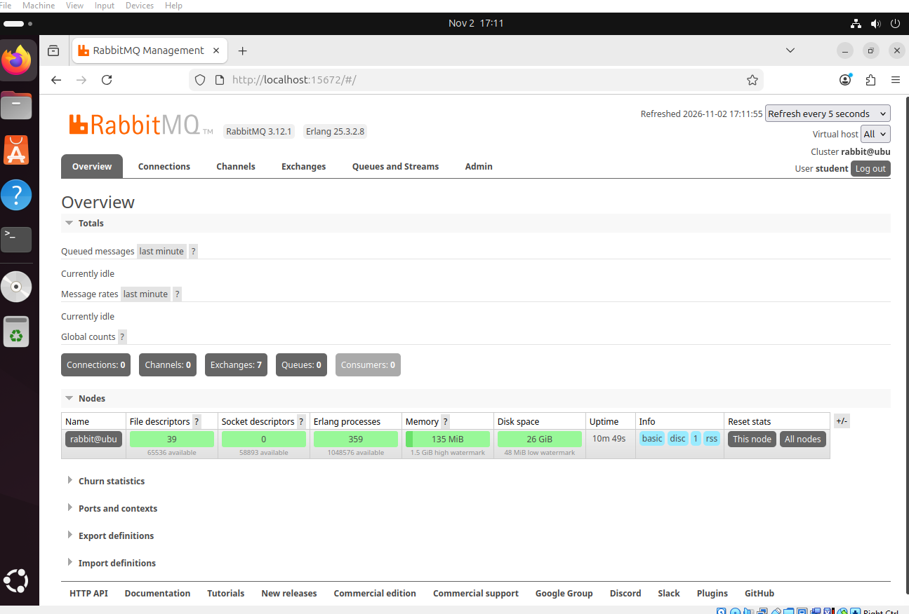
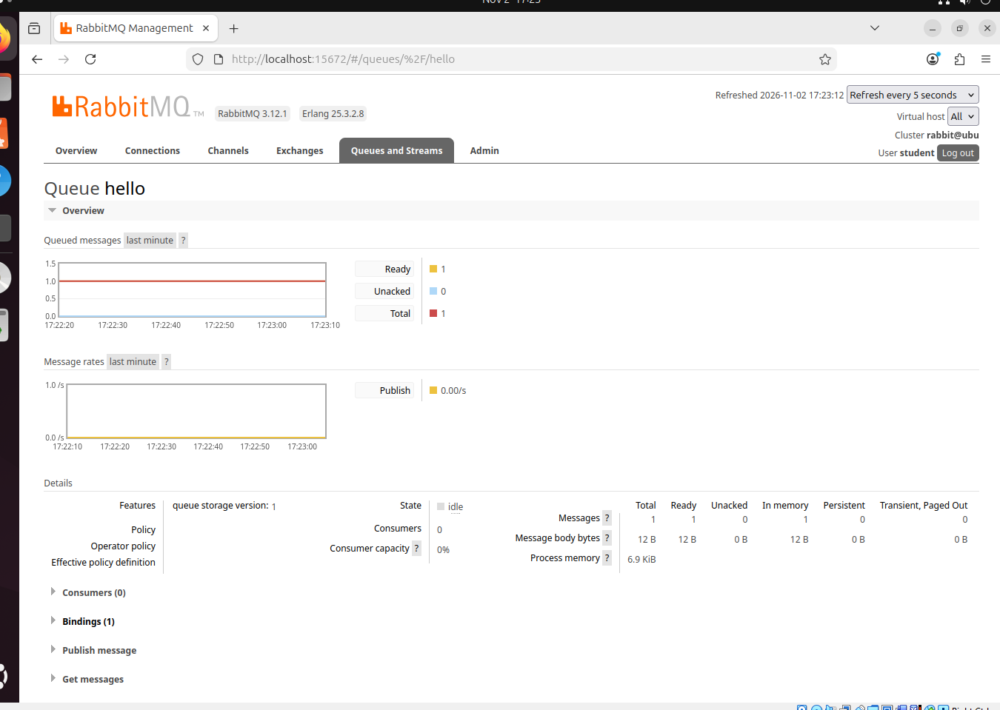
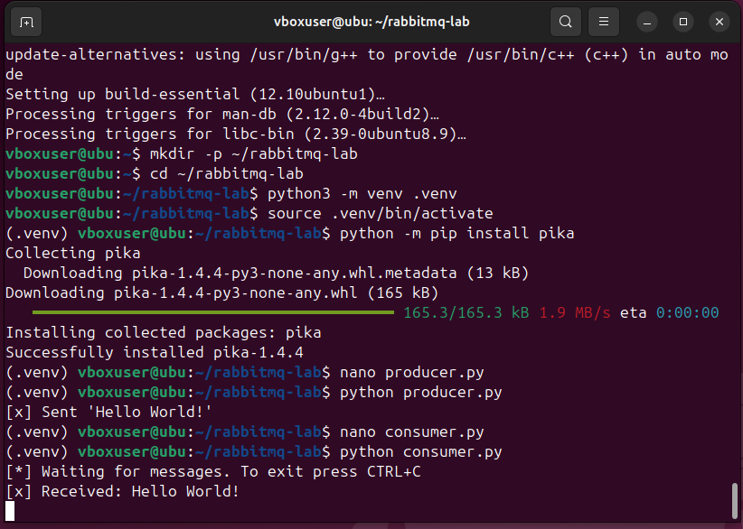

# # Домашнее задание к занятию «Очереди RabbitMQ» — Petrov Pavel
## Задание 1



## Задание 2





### Задание 3

## Задание 3. Подготовка HA-кластера

### Ограничение практического выполнения

Для выполнения задания подготовлена вторая виртуальная машина
путём полного клонирования первой в Oracle VirtualBox.

На обеих ВМ добавлен второй сетевой адаптер типа Internal Network
с именем сети rabbitnet. На первой машине настроен адрес
192.168.50.10/24.

Однако выполнить практическую часть до конца не удалось.
Компьютер имеет 8 ГБ оперативной памяти. При одновременном
запуске двух ВМ система и виртуальные машины зависают.
Уменьшение выделенной памяти до 2048 МБ на каждую ВМ
не решило проблему.

Поэтому ниже приведён план настройки кластера.
Команды объединения нод, создания политики и проверки
отказоустойчивости не выполнялись. Скриншоты работающего
кластера и фактический вывод cluster_status отсутствуют.

### План настройки

Для двух нод предполагаются следующие параметры:

| Нода | IP-адрес |
|---|---|
| rmq01 | 192.168.50.10 |
| rmq02 | 192.168.50.11 |

На обеих машинах в файл /etc/hosts необходимо добавить:

```text
192.168.50.10 rmq01
192.168.50.11 rmq02
```

После настройки адресов и уникальных имён машин необходимо
проверить разрешение имён и сетевую связность:

```bash
ping -c 3 rmq01
ping -c 3 rmq02
```

На обеих нодах должны быть совместимые версии RabbitMQ и Erlang,
а файл /var/lib/rabbitmq/.erlang.cookie должен содержать одинаковое
значение и иметь корректные права доступа.

Для данного учебного задания предполагается использование
RabbitMQ 3.12.1, как в выполненных заданиях 1 и 2.

### Объединение нод

После подготовки имён, сети и Erlang cookie на второй ноде
планируется выполнить:

```bash
sudo rabbitmqctl stop_app
sudo rabbitmqctl reset
sudo rabbitmqctl join_cluster rabbit@rmq01
sudo rabbitmqctl start_app
```

Внимание: reset сбрасывает локальное состояние RabbitMQ.
Команду следует выполнять только на подготовленной второй
учебной ноде, данные которой не требуется сохранять.

После объединения на каждой машине необходимо проверить кластер:

```bash
sudo rabbitmqctl cluster_status
```

Критерий успешного результата — обе ноды rabbit@rmq01
и rabbit@rmq02 отображаются в составе кластера и работают.

### Создание политики ha-all

На одной из нод кластера планируется выполнить:

```bash
sudo rabbitmqctl set_policy -p / ha-all "^" \
  '{"ha-mode":"all","ha-sync-mode":"automatic"}' \
  --apply-to queues
```

Политика должна применяться ко всем очередям виртуального хоста /.

После применения необходимо проверить политику:

```bash
sudo rabbitmqctl list_policies -p /
```

Также необходимо проверить наличие обеих нод во вкладке Overview
и политики ha-all в разделе Admin → Policies веб-интерфейса.

### План проверки отправки сообщений и отказоустойчивости

1. В producer.py указать адрес первой ноды — 192.168.50.10 —
   и действительные учётные данные RabbitMQ.
2. Отправить сообщение в очередь hello.
3. Убедиться, что очередь имеет синхронизированную зеркальную копию
   на второй ноде.
4. На каждой ноде проверить сообщение через rabbitmqadmin.
   Использовать режим с возвратом сообщения в очередь:

   rabbitmqadmin -u student -p '<пароль>' get \
     queue=hello ackmode=ack_requeue_true

5. Сохранить скриншоты выполнения команды на обеих нодах.
6. Остановить первую ноду.
7. В consumer.py изменить адрес подключения на 192.168.50.11.
8. Запустить consumer.py и проверить получение сообщения.
9. Сохранить скриншот результата.

Перечисленные проверки являются планом выполнения.
Фактическая отказоустойчивость кластера не проверена.
