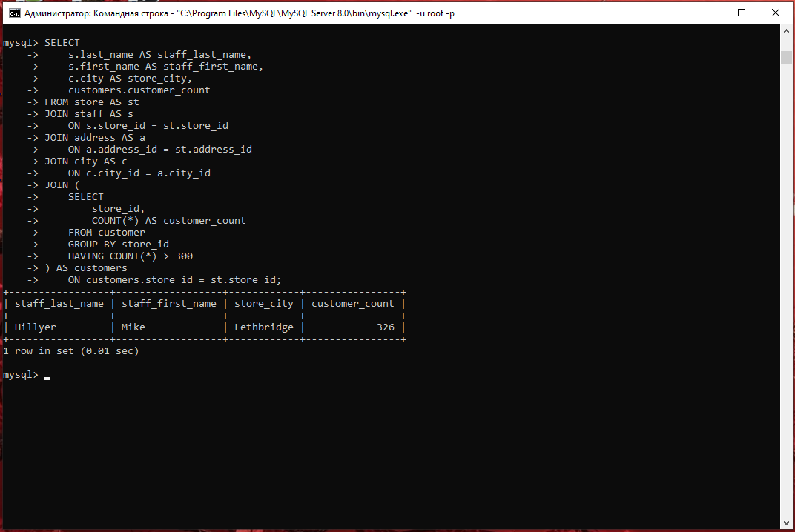
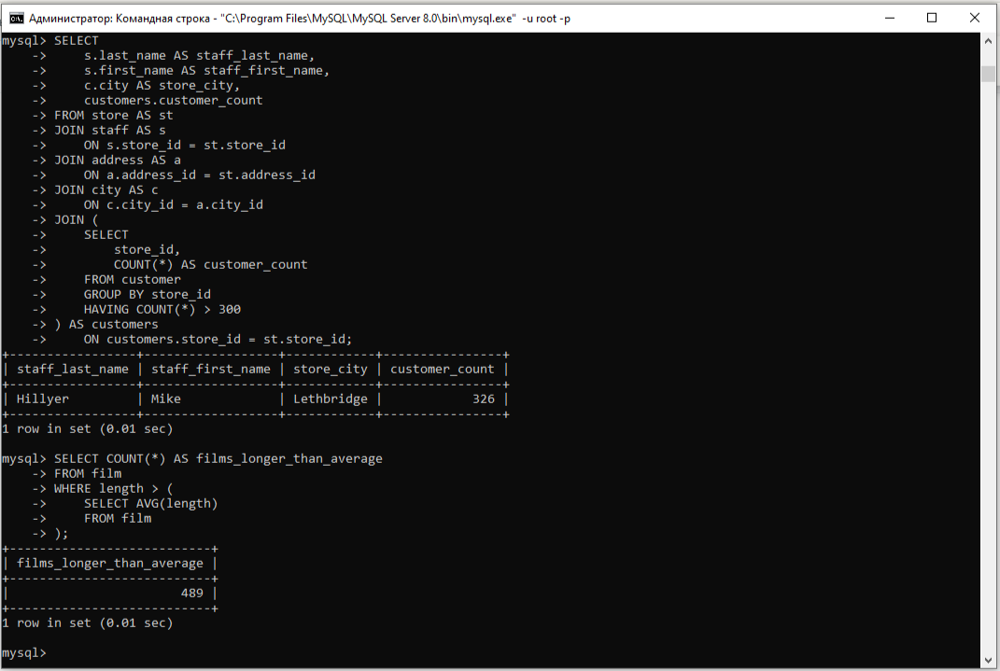
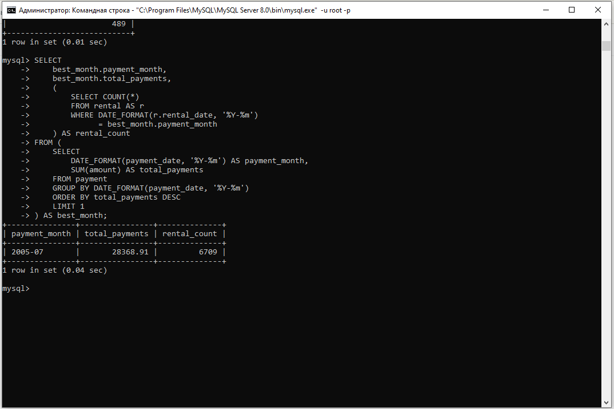

# Домашнее задание к занятию «SQL. Часть 2» — Petrov Pavel

Задания выполнены в командной строке Windows с использованием
MySQL Command Line Client и учебной базы данных Sakila.
Версия сервера: MySQL Community Server 8.0.46.

## Задание 1

Одним запросом получить информацию о магазине,
к которому прикреплено более 300 покупателей:
фамилию и имя сотрудника, город магазина и количество покупателей.

### SQL-запрос

```sql
SELECT
    s.last_name AS staff_last_name,
    s.first_name AS staff_first_name,
    c.city AS store_city,
    customers.customer_count
FROM store AS st
JOIN staff AS s
    ON s.store_id = st.store_id
JOIN address AS a
    ON a.address_id = st.address_id
JOIN city AS c
    ON c.city_id = a.city_id
JOIN (
    SELECT
        store_id,
        COUNT(*) AS customer_count
    FROM customer
    GROUP BY store_id
    HAVING COUNT(*) > 300
) AS customers
    ON customers.store_id = st.store_id;
```

### Результат

Подзапрос подсчитывает покупателей каждого магазина.
Условие HAVING оставляет магазины, к которым прикреплено
более 300 покупателей. Основной запрос добавляет
информацию о сотрудниках и городе магазина.

### Скриншот



## Задание 2

Получить количество фильмов, продолжительность которых
больше средней продолжительности всех фильмов.

### SQL-запрос

```sql
SELECT COUNT(*) AS films_longer_than_average
FROM film
WHERE length > (
    SELECT AVG(length)
    FROM film
);
```

### Результат

Количество фильмов: 489.

Подзапрос вычисляет среднюю продолжительность всех фильмов.
Основной запрос подсчитывает фильмы, продолжительность
которых строго больше среднего значения.

### Скриншот



## Задание 3

Определить месяц с наибольшей суммой платежей
и количество аренд, оформленных за этот месяц.

### SQL-запрос

```sql
SELECT
    best_month.payment_month,
    best_month.total_payments,
    (
        SELECT COUNT(*)
        FROM rental AS r
        WHERE DATE_FORMAT(r.rental_date, '%Y-%m')
              = best_month.payment_month
    ) AS rental_count
FROM (
    SELECT
        DATE_FORMAT(payment_date, '%Y-%m') AS payment_month,
        SUM(amount) AS total_payments
    FROM payment
    GROUP BY DATE_FORMAT(payment_date, '%Y-%m')
    ORDER BY total_payments DESC
    LIMIT 1
) AS best_month;
```

### Результат

Наибольшая сумма платежей получена в июле 2005 года.

Подзапрос best_month группирует платежи по году и месяцу,
вычисляет сумму и выбирает месяц с максимальной суммой.
Затем подсчитываются аренды по rental_date за тот же год и месяц.

### Скриншот

